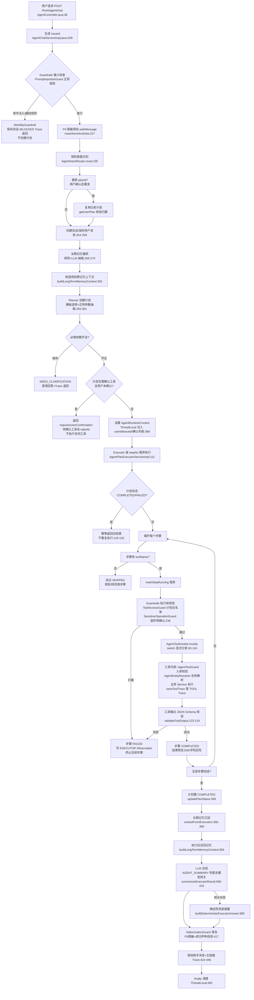

# Job-Agent Agent 核心架构深度审计报告

> 审计方式：纯静态代码审计 + 非破坏性构建验证（`mvn compile` 通过；单元测试以 JUnit Platform Launcher 独立运行验证）。
> 审计范围：`Job-Agent-backend`（Bootstrap / Framework / Infra-Ai / Mcp-Tools 四模块）、`sql/`、配置文件、单元测试、前端 Agent API 调用。
> 路径基准：仓库根 `D:/workspace/Job-Agent`。所有结论均附代码路径与行号；无证据处明确标注"未找到证据"。
> **本轮未修改任何业务代码、未删除文件、未改数据库。仅新增本报告与 `docs/agent-core-roadmap.md`。**

---

## 1. 执行摘要

Job-Agent 的后端是一套**「规则意图识别 → 模板化计划（Planner）→ 后端确定性执行（Executor）→ LLM 总结」的 Plan-and-Execute 混合架构**，其中"规划"和"工具选择"完全由代码模板与正则完成，大模型只承担两件事：**长期记忆抽取**与**执行结果总结**。它不是 ReAct Agent（模型不参与逐步决策循环），也不是 Workflow Agent（无 DAG/条件分支），更不是 LangChain4j 原生 Tool Calling Agent（主链路不经过 LangChain4j 的 AiServices/工具调用循环）。

项目最值得肯定的部分是**工程质量骨架**：分层清晰的 Guardrails（输入注入检测 / 工具越权拦截 / 输出 JSON 校验 / 幻觉降级 / PII 脱敏）、贯穿 traceId 的 Trace + Observation 双轨可观测性、带熔断/主备/成本统计的自研模型网关、版本化 Prompt 运行时、以及"写入→召回→注入→影响回答"真实闭环的长期记忆系统。这些都不是摆设，均有真实调用点和部分测试。

最需要警惕的是三个"名实不符"与三个"深度缺口"：

- **名实不符**：① `Job-Agent-Mcp-Tools` 模块没有任何 MCP 协议实现，6 个 Connector 全部返回 `PREVIEW` 桩；② `Job-Agent-Infra-Ai` 的 5 个 LangChain4j Assistant 被 `legacy-enabled=false` 整体关闭且无任何调用方（死代码层）；③ `application-local.yml` 里的 `job.mcp` stdio 配置无任何代码消费（死配置，且该文件未入库）。
- **深度缺口**：① RAG 基础设施齐全但**预检索主链路是死代码**（`retrieveRagContext` 零调用），实际只服务"通用闲聊"一个意图，且 pgvector 向量索引因维度超限被跳过（2048 维 > ivfflat 上限 2000），检索退化为全表扫描；② Executor 只有**计划级幂等**，无步骤级幂等，中途失败后无法恢复重试（失败计划永久锁死）；③ 测试体系有 43 个可运行单测且全部通过，但**标准 `mvn test` 因 1 个过期测试文件编译失败而整体挂掉**，且零集成测试。

整体判断：**具备初步工程化的 Agent 系统**。核心 Agent 闭环真实可运行、工程防护体系超出一般课程项目水平；但"智能"部分（规划、检索、上下文）大量依赖模板与规则，距离"具备较完整工程能力的 Agent 系统"差在动态规划、RAG 主链路接入与可靠性验证三件事上。

---

## 2. 项目整体 Agent 架构（从代码还原）

### 2.1 架构定性：模板化 Plan-and-Execute + 规则前置 + LLM 后置总结

判定依据（不是类名，是代码逻辑）：

| 判定问题 | 代码事实 | 证据 |
|---|---|---|
| 用户输入如何进入 Agent | `POST /front/agent/chat`，userId 从 sa-token 登录态取，禁止前端伪造 | `Job-Agent-Bootstrap/src/main/java/com/job/bootstrap/controller/front/AgentController.java:38-54` |
| 意图如何识别 | **纯关键词规则**，7 类意图 + 默认通用问答，无模型参与 | `agent/intent/AgentIntentRouter.java:26-99`（注释自述"第一版使用规则识别……后续可升级为大模型兜底"） |
| 模型是否参与规划 | **不参与**。计划 = 意图 → 固定模板；参数 = 正则抽取 | `agent/plan/AgentPlanTemplateFactory.java:29-40`（`switch (intentCode)` 返回硬编码模板）；`agent/plan/AgentPlanParameterExtractor.java:21-86`（正则） |
| Planner 如何生成计划 | `createPlan` 选模板 → 检查必填参数 → 计划/步骤落库，缺参即 `NEED_CLARIFICATION` | `service/impl/AgentPlanningServiceImpl.java:100-154` |
| Executor 如何调度 | 按 `stepNo` 升序**确定性循环**，一步失败跳过后续全部步骤，计划置 `FAILED` | `service/impl/AgentPlanExecutorServiceImpl.java:133-152` |
| Tool 如何选择 | 模板步骤里写死工具名；唯一的动态选择是"搜索/推荐二选一"按 `userGoal` 是否含"推荐/适合/偏好" | `AgentPlanExecutorServiceImpl.java:465-484` |
| 工具参数如何生成 | 计划级 `extractedParams`（正则结果）原样传给每个步骤，**无步骤间数据依赖** | `AgentPlanExecutorServiceImpl.java:495-503`（`buildExecutionParams` 只补 `message/query` 兜底） |
| 工具结果如何反馈模型 | 工具 JSON 结果 + 计划快照 + 召回记忆拼成总结提示词，一次调用生成最终答复 | `AgentChatServiceImpl.java:988-1049`（`buildExecutorSummaryMessage`） |
| 是否可重新规划 | **不可**。没有"执行结果 → 再规划"回路；计划创建后只执行一次 | 全链路无 replan 调用点 |
| 何时结束 | 所有步骤执行完（COMPLETED）或任一步骤失败（FAILED） | `AgentPlanExecutorServiceImpl.java:154` |
| 用户确认如何介入 | 服务端强制：计划步骤中 `requiresUserConfirmation=true` 的工具，未在 `confirmedToolNames` 中则整轮不执行，返回待确认列表；确认后带 `planId` 再次请求 | `AgentChatServiceImpl.java:331-358`（计划层预检）；`agent/guardrail/SensitiveOperationGuard.java` + `agent/schema/AgentToolGuard.java:189-201`（执行层强制，双重保险） |
| 异常如何恢复 | 计划级幂等：COMPLETED/FAILED 的计划直接返回旧结果不重跑；**失败计划无法恢复**（永远返回"请重新发起任务"，但重新发起会创建新计划，旧计划作废） | `AgentPlanExecutorServiceImpl.java:120-125` |

**结论：这是"模板规划 + 确定性执行 + LLM 总结"的混合式 Agent。** 模板规划保证可控与可演示，但也意味着：模型不会根据中间结果改变行动路线，多步骤任务没有条件分支，复杂任务（如"搜索岗位→逐一匹配→生成话术→发邮件"）无法用一条用户消息驱动。

### 2.2 核心执行流程图（按代码真实顺序）

> 注意：图中"RAG 预检索"步骤在注释里设计过（`AgentChatServiceImpl.java:545-552`），但对应方法 `retrieveRagContext`（`:553`）**零调用**，是死代码，因此不画进主流程。RAG 实际只通过 `RagSearchTool.searchKnowledge` 在 GENERAL_CHAT 计划中经由 Executor 执行（详见 4.5）。

### 2.3 真实业务链路追踪（3 条）

#### 链路一：用户要求"简历和岗位匹配分析"（JOB_MATCH）

| 环节 | 详情 |
|---|---|
| 入口 API | `POST /front/agent/chat`，body 含 message（如"帮我看下「XX简历」和「Java 后端开发」匹配吗"） |
| 核心类/方法 | `AgentController.chat:39` → `AgentChatServiceImpl.chat:193` → `AgentIntentRouter.route`（命中"匹配"→`JOB_MATCH`，`AgentIntentRouter.java:39-41`）→ `AgentPlanningServiceImpl.createPlan:100` |
| 参数抽取 | `AgentPlanParameterExtractor` 正则解析「」引号对 → `resumeName` + `jobTitle`（`AgentPlanParameterExtractor.java:41-51, 88-102`）；模板 `jobMatchPlan` 要求 `resumeId/jobId`，名称作为等价替代（`AgentPlanningServiceImpl.java:201-206`） |
| 计划步骤 | 步骤1"确认匹配对象"（无工具，SKIPPED）；步骤2 `JobMatchTool.matchJob`（`AgentPlanTemplateFactory.java:58-71`） |
| 模型参与位置 | **规划与执行均无模型**；仅在最后总结（AGENT_SUMMARY）参与一次 |
| 工具调用位置 | `AgentPlanExecutorServiceImpl.executeToolStep:216` → `AgentToolInvoker.invoke:69-74` → `JobMatchTool.matchJob` → `JobMatchService`（匹配算法在业务层） |
| 用户确认 | `JobMatchTool.matchJob` 副作用为 `WRITE_BUSINESS_RECORD` 但 `confirmationType=NONE`，`mustConfirm` 返回 false（`SensitiveOperationGuard.java` 逻辑），**无需确认直接执行** |
| 状态变化 | plan: PLANNED→COMPLETED；step2: PENDING→RUNNING→COMPLETED；写入 `agent_plan_step.result_summary`（1000 字符预览） |
| 成功路径 | 工具 JSON 过校验 → 步骤完成 → 计划完成 → 记忆沉淀 → LLM 总结 → PII 脱敏 → 答复 |
| 失败路径 | ① 参数缺 → NEED_CLARIFICATION 澄清轮（`:304-329`）；② 简历/岗位名称解析失败或多候选 → 工具返回 `needClarification` 候选列表（`GreetingGenerateTool.java:92-96` 同款逻辑，JobMatchTool 同理）→ 步骤算成功、总结呈现候选；③ 工具异常 → 步骤 FAILED、计划 FAILED、跳过总结直接由兜底摘要呈现（`:457-476` catch 落 FAILED Trace） |
| Trace 记录 | 主 Trace：`AgentChatServiceImpl.java:435-446`；工具 Trace：`JobMatchTool` 内部 `saveToolTrace`；EXECUTOR Observation：`AgentPlanExecutorServiceImpl.java:301, 327-335`；MODEL 事件（token/成本）：`AiModelGatewayServiceImpl.java:431-449` |

#### 链路二：用户要求"生成 HR 打招呼语"（副作用工具确认链路）

这是唯一完整走"用户确认"闭环的链路：

1. 用户消息命中"打招呼/开场白"→ `GREETING_GENERATE`（`AgentIntentRouter.java:69-71`）；
2. `greetingPlan` 要求 `resumeId/jobId`（名称可替代）；缺参则 `NEED_CLARIFICATION`（`AgentPlanTemplateFactory.java:73-88`）；
3. 参数齐全时 `findUnconfirmedTools`（`AgentChatServiceImpl.java:699-714`）发现 `GreetingGenerateTool.generateGreeting` 的 Schema 为 `REQUIRED_BEFORE_EXECUTION`（`AgentToolSchemaRegistry.java:232-234`）→ 返回 `requiresUserConfirmation=true` + `planId` + 确认话术（`:727-740`），**不创建沟通记录、不调用任何工具**；
4. 用户在前端点击确认后，带 `planId` + `confirmedToolNames=["GreetingGenerateTool.generateGreeting"]` 再次请求（`AgentController.java:39-51`）；
5. 服务端复用旧计划（`:243-248`），确认列表非空 → 放行；`AgentRuntimeContext` 携带确认集合（`:368-374`）；
6. 执行时**双重强制校验**：计划层 `findUnconfirmedTools` 已过；执行层 `SensitiveOperationGuard.assertSensitiveOperationAllowed` 再次检查 `AgentRuntimeContext.isToolConfirmed`（`SensitiveOperationGuard.java` + `AgentToolGuard.java:189-201`）——**确认由服务端强制，不是前端按钮**；
7. `GreetingGenerateTool.generateGreeting:61-130` 解析简历/岗位（`AgentEntityResolver`，多候选返回候选列表）→ `JobGreetingService` 生成话术并**自动创建沟通记录** → `saveToolTrace` → 输出 JSON 校验 → 步骤/计划完成 → LLM 总结。

失败路径：确认后岗位名称命中多个岗位 → 工具返回 `needClarification=true` + candidates（`GreetingGenerateTool.java:92-96`）→ 步骤标记成功、总结引导用户明确岗位。

#### 链路三：通用求职问答（RAG 唯一入口 + RAG 失败无降级）

1. 消息不命中任何关键词 → `GENERAL_CHAT` → `generalChatPlan`（`AgentPlanTemplateFactory.java:151-165`）；
2. 步骤1 = `RagSearchTool.searchKnowledge`，步骤2 = 无工具的回答生成；
3. `RagSearchTool` 调 `RagRetrievalService.search`（pgvector 向量 + MySQL LIKE 双路召回，规则重排）；
4. **若 RAG 失败（pgvector 连接失败、embedding 超时等）**：`AgentToolInvoker` 捕获 → `success=false` → 步骤 FAILED → **整个计划 FAILED**，后续"生成回答"步骤被 SKIPPED（`AgentPlanExecutorServiceImpl.java:148-151`）→ 总结阶段只能产出失败说明。而那套完整的"RAG 失败不中断聊天 + Trace 标记 ragStatus=FAILED"的降级代码写在死方法 `retrieveRagContext`（`AgentChatServiceImpl.java:590-622`）里，永远不会触发；
5. Trace：RAG 检索落为 TOOL 事件（`AgentChatServiceImpl.java:571-581`，死代码路径）或工具内 Trace（活路径）。

---

## 3. Agent 主要模块逐项审计

### 3.1 Planner：任务规划能力 —— 模板规划，非自主规划

**当前实现**：`AgentPlanningServiceImpl.createPlan`（`service/impl/AgentPlanningServiceImpl.java:100-154`）做三件事：正则抽取参数 → `AgentPlanTemplateFactory.create` 按意图返回硬编码模板 → 必填参数检查后计划和步骤落库。模板共 8 个（7 个业务意图 + 通用），每个 1-2 个步骤，步骤的工具名、入参说明、完成条件全部写死（`AgentPlanTemplateFactory.java:42-165`）。

**关键代码**：`agent/plan/AgentPlanTemplateFactory.java:29-40`（switch 选择模板）；`agent/plan/AgentPlanParameterExtractor.java:21-86`（12 组正则 + 城市/关键词词表）。

**实现程度**：**基础实现（模板规划）**。类注释自述"避免模型自由发挥导致步骤不可控"（`AgentPlanningServiceImpl.java:52`）。

**工程优点**：计划可解释、可落库、可回放；必填参数缺失走澄清而非硬猜；参数抽取允许"简历名称/岗位名称"替代 ID，最终解析交给 `AgentEntityResolver`，分层合理。

**技术局限**：
- 无 LLM 参与规划，无动态计划生成，无步骤间数据依赖（`buildExecutionParams` 把同一份计划级参数发给所有步骤，`AgentPlanExecutorServiceImpl.java:495-503`）；
- 无条件分支、无循环（"批量匹配 N 个岗位"这类任务无法表达）；
- 无最大深度/循环/Token 限制概念——因为根本没有动态规划；
- 无规划失败重试、无执行反馈重规划；
- 正则参数抽取脆弱：城市/关键词靠词表匹配（`AgentPlanParameterExtractor.java:53-61`），词表外的表达全部丢失。

**与 ReAct / Plan-and-Execute 的区别**：典型 Plan-and-Execute 的"Plan"由 LLM 根据目标动态生成步骤列表，执行后可 Replan；本项目是"意图 → 硬编码模板"，属于**静态规划**。与 ReAct 的区别更本质：ReAct 中模型每轮观察（Observation）后自主决定下一个 Action（工具调用），本项目中模型在工具执行前完全不参与，执行后只参与一次总结。

**测试证据**：`AgentPlanParameterExtractorTest` 覆盖引号对/legacy ID 抽取（测试通过，见 §6）。

**是否值得优化**：值得，但建议**渐进式**：先做"规则意图 + LLM 兜底分类"（意图层），再考虑"模板 + LLM 动态补步"（计划层），不建议一上来全盘 LLM 规划（会破坏现有的可解释性与 Guardrails 白名单模型）。方案见 roadmap。

### 3.2 Executor：工具执行引擎

**当前实现**：`AgentPlanExecutorServiceImpl.executePlan`（`service/impl/AgentPlanExecutorServiceImpl.java:112-172`）：加载计划 → 计划级幂等检查 → 按 `stepNo` 循环 → 每步 `markStepRunning` → Guardrails 校验 → `AgentToolInvoker.invoke` → 成功/失败回写步骤状态 + EXECUTOR Observation → 更新计划状态 → 触发记忆沉淀。

**关键代码**：`:120-125`（幂等）；`:133-152`（主循环）；`:216-278`（单步执行，含 ThreadLocal 计划步骤注入）；`:236-241`（Guardrails）；`:465-484`（工具二选一路由）。

**实现程度**：**核心功能已实现，可靠性不足（3/5）**。

**工程优点**：
- 执行状态完整落库（PENDING/RUNNING/COMPLETED/FAILED/SKIPPED 五态），后台可回放；
- 计划级幂等防止整计划重复执行（注释明确动机是"避免重复生成评分、匹配、沟通记录"）；
- 每步都写 Observation，与工具内部 TOOL 事件互补；
- ThreadLocal 上下文 + finally 清理，防线程池串用户（`AgentRuntimeContext.java:17` 有专门警告注释）；
- `@Transactional` 包裹，步骤状态回写与计划状态更新同事务。

**技术局限与隐藏问题**：
1. **无步骤级幂等**：循环不检查步骤当前状态。若执行中途进程崩溃/DB 抖动导致计划停留在 PLANNED（部分步骤已 COMPLETED），用户重试会**从头重跑所有步骤**——步骤1 的副作用工具（如 GreetingGenerateTool 建沟通记录）会**重复执行业务写入**；
2. **失败计划不可恢复**：FAILED 计划永远返回"请重新发起任务"（`:123-125`），而"重新发起"在 `AgentChatServiceImpl` 里意味着新建计划（只有带 `planId` 才复用，但复用后又被幂等挡回）——用户视角是"重试无效"，只能重新打字；
3. **无执行超时**：工具同步执行，慢工具（外部 API）会占住请求线程，无超时中断；
4. **无重试机制**：步骤失败即终失败，没有"可重试错误码"概念（Schema 里定义了 `retryable` 字段——`AgentToolSchemaRegistry.java:620-626`——但 Executor 从不读取）；
5. **步骤间无数据传递**：每个工具拿到的是同一份计划级参数；
6. `chooseExecutableToolName` 的"搜索/推荐二选一"靠 `userGoal.contains("推荐")` 字符串判断（`:480`），与意图路由的关键词判断重复且脆弱；
7. 失败步骤的后续步骤统一 SKIPPED，但 SKIPPED 也落库并写 Observation——失败计划的步骤状态机会留下 RUNNING 残留（崩溃场景）。

**测试证据**：无 Executor 直接测试（未找到证据）。

### 3.3 Tool Calling 与 Tool Schema

**当前实现**：四层机制并存，必须严格区分：

| 方式 | 是否存在 | 证据 |
|---|---|---|
| ① 普通 Java 方法调用 | **是，主链路唯一实际使用的方式** | `AgentToolInvoker.java:63-116`：硬编码 `switch (toolName)` 显式分发，注释自述"第一版不使用反射，是为了让参数映射更可控" |
| ② 自定义工具路由/Schema | 是 | `AgentToolSchemaRegistry`（构造函数硬编码 16 个 Schema：8 业务 + 8 连接器）+ `AgentToolGuard`（入参校验）+ 别名解析 |
| ③ LLM 原生 Function Calling | **否**（主链路） | 工具类上有 `@Tool`/`@P` 注解（LangChain4j 风格，如 `GreetingGenerateTool.java:48-59`），但主链路调用的是**无注解的重载方法**（`:61`），注解重载没有活跃调用方 |
| ④ MCP 协议调用 | **否** | 无任何 MCP SDK/传输/JSON-RPC 代码，见 §5.10 |

**模型如何得知可用工具**：模型不知道。工具集对模型不可见，总结提示词里只有执行结果 JSON（`AgentChatServiceImpl.java:1037-1038`）。这是"后端决定工具"而非"模型选择工具"的架构。

**Schema 质量**：`AgentToolSchema` 结构相当完整——参数名/类型/必填/来源/示例/默认值、输出字段、错误码（含 `retryable`）、副作用类型、确认类型、确认文案（`AgentToolSchemaRegistry.java:532-566`）。入参校验 `AgentToolGuard.validate`：权限（LOGIN_USER 必须有 userId）→ 必填（允许 resumeName/jobTitle 替代 ID）→ 类型（宽松：数字接受数字字符串）→ 确认策略（`:40-51, 122-201`）。

**局限**：
- 工具参数完全来自正则抽取，**无参数注入面**（这是优点）但也无智能填补；
- 工具权限只有 `LOGIN_USER` 一档（`AgentToolSchemaRegistry.java:556`），无按用户角色/数据归属细分——数据归属靠各工具内部 `AgentEntityResolver` + Service 层 userId 过滤兜底；
- 新增工具要改 3 处（Tool 类、Registry 硬编码、Invoker switch），`agent_tool_schema` 表迁移停留在注释（`AgentToolSchemaRegistry.java:36-39`）；
- 连接器工具（Email/Calendar 等）在 Invoker 里统一路由到 `adminExternalConnectorService.preview`（`AgentToolInvoker.java:104-110`），只返回预览。

**测试证据**：`AgentToolSchemaRegistryTest`（别名解析、A/B 表达式解析，通过）。

### 3.4 Memory：长期记忆系统

**当前实现**：双轨写入 + 画像压缩 + 双注入点。

- **写入**：`AgentMemoryCaptureServiceImpl`（`service/impl/AgentMemoryCaptureServiceImpl.java:100-115`）先由 `AgentMemoryActionClassifier` 分类动作（SET/UPDATE/DELETE/ASK/NORMAL），仅 SET/UPDATE 进入写入；规则提取（`AgentMemoryRuleExtractor.java:70-84`，7 类固定槽位，confidence 0.85/0.95）+ LLM 提取（`AgentMemoryLlmExtractor.java:54-77`，MEMORY_EXTRACT 场景，最多 5 条）合并，**规则优先**（`AgentMemoryCaptureServiceImpl.java:206-242`）；
- **写入策略**：`AgentMemoryWritePolicy.java:43-86`：confidence≥0.60、value≤1000 字符、过滤手机号/邮箱/身份证/敏感词、过滤疑问句（词表含"吗/什么"等，有误杀风险）；
- **落库去重**：按 `userId+memoryType+memoryKey` upsert，每次变更写 `agent_memory_history`，值不同标记 `conflictDetected`（`AgentMemoryServiceImpl.java:103-162, 427-449`）；
- **画像**：`AgentMemoryContextServiceImpl` 按固定 key 顺序拼接 12 槽位 + 最多 4 条其他信息，≤700 字符，受 100 条上限截断（`:227-323`）；
- **召回**：MySQL 取 100 条候选 → Java 内存打分（importance×2+confidence + query 词命中 key/summary/value 加权）→ 取 top 5-8（`AgentMemoryServiceImpl.java:174-208, 522-555`）；单条 ≤120 字符、总上下文 ≤1600 字符截断；
- **注入点**：① Planner 参数抽取前拼接记忆上下文（`AgentChatServiceImpl.java:283` → `AgentPlanningServiceImpl.java:108-109, 156-161`）；② Summary 提示词注入画像 + 召回记忆（`AgentChatServiceImpl.java:394-398, 1000-1025`）。

**实现程度**：**核心链路完整（3/5）**——这是全项目闭环最真实的模块：写入→画像→召回→影响规划与回答→lastUsedTime 回写，全部有活跃调用点。

**局限与问题**：
1. **无有效期机制**：无 TTL 字段、无过期清理（全仓库无 expire/ttl 命中），记忆只增不减；
2. **召回质量弱**：词重叠打分，无语义理解；query 分词仅按标点/空格切（≤40 字符整句 + 切分），中文长 query 几乎打不中；
3. **读引发写放大 + 马太效应**：每次召回逐条 `updateById` 写 lastUsedTime/updateTime（`AgentMemoryServiceImpl.java:557-568`），被 touch 的记忆 updateTime 变新后长期占据候选前列；
4. **LLM 抽取 key 不归一**：模型自造 memoryKey（`AgentMemoryLlmExtractor.java:157-173` 只校验非空），与规则固定 key 两套命名体系，同事实可能多条并存（merge 只在本轮内生效）；
5. **冲突只记录不解决**：`conflictDetected=1` 无任何消费方，低置信度来源可覆盖高置信度旧值；
6. **写了没人读的数据**：`lastUsedTime`（只写无读）、`profileVersion`（只自增）、`findLatestMemoryValue` 接口（零调用）、`last_generated_greeting` 等 4 类工具结果记忆不在画像 key 顺序里，仅靠"其他重要信息"最多 4 条×80 字符偶然露面；
7. **无用户自助入口**：删除/纠正只能靠自然语言（关键词表驱动）或 Admin 后台。

**测试证据**：`AgentMemoryRuleExtractorTest`、`AgentMemoryActionClassifierTest`（通过）。

### 3.5 RAG：检索增强生成

**当前实现**：基础设施层代码齐全——

- 索引：`RagIndexServiceImpl` 组文档 → `RagTextSplitter` 定长滑窗切片（500 字符/80 overlap，`RagProperties`）→ MySQL `rag_document/rag_chunk` 可视化层 → 逐 chunk 调火山方舟 embedding（2048 维）→ pgvector `job_knowledge` 表 upsert；
- 检索：`RagRetrievalServiceImpl.search` 双路召回（pgvector cosine + MySQL LIKE，要求 `vectorStatus=INDEXED`）→ 规则重排 `semantic×0.65 + keyword×0.35 + hybrid 0.08`；
- 权限：向量层 SQL `user_id IN (0, ?)` + MySQL 层 `canRead` 双重校验，用户隔离设计正确；
- 引用：`引用N: 类型/标题#chunkIndex` 回填 documentId/chunkId。

**实现程度**：**基础实现，且未接入主链路（2/5）**。

**关键问题（按严重度）**：
1. **主链路未接入（最严重）**：`retrieveRagContext`（`AgentChatServiceImpl.java:553-623`）及依赖它的 `buildRagEnhancedMessage`（`:633`）、`buildChatTraceInput`（`:1259`）、`buildChatTraceOutput`（`:1269`）**全部零调用**。"每次聊天先 RAG 预检索"的设计没有生效，`chat()` 主流程（`:193-484`）无任何 RAG 调用；
2. **RAG 实际只服务 GENERAL_CHAT 一个意图**：7 个业务意图（简历分析、岗位匹配、打招呼等最需要私有知识的场景）的计划模板里没有 RAG 步骤（`AgentPlanTemplateFactory.java:151-165` 仅 default 分支含 RagSearchTool）；
3. **向量索引被跳过**：ivfflat 仅在维度 ≤2000 时创建（`RagVectorStoreServiceImpl.java:104-109`，常量 `PGVECTOR_IVFFLAT_MAX_DIMENSION=2000`），当前配置 2048 维 → **全表精确扫描**，数据量增长后性能崩塌；
4. **RAG 失败无降级**：RagSearchTool 异常直接令计划 FAILED（`AgentPlanExecutorServiceImpl.java:148-151`），而降级逻辑在死代码里；
5. 无连接池（`DriverManagerDataSource`，`RagConfig.java:35`）；无元数据过滤（检索 SQL 仅 user_id）；无查询改写；rerank 是规则公式；关键词路是全表 LIKE；`contentHash` 写了从不比较（增量同步永远是删了重建）；索引同步只靠 Admin 接口/workflow，业务数据变更不触发；`maxRetries=2` 配置未实现。

**RAG 是否提升回答效果**：**尚无证据**。没有检索质量实验、没有评测数据集中 RAG 用例的运行报告、没有 A/B。只能确认"检索接口可用、权限隔离正确、引用编号生成"。

**测试证据**：无（未找到 RAG 测试）。

### 3.6 Guardrails：安全与权限控制

**当前实现**：5 类防护，全部进入实际请求主链路：

| 防护 | 组件 | 嵌入点 | 实现方式 |
|---|---|---|---|
| Prompt 注入/越狱检测 | `PromptInjectionGuard` | `AgentChatServiceImpl.java:217-220`（Planner 之前） | 10 条中英正则（ignore previous instructions / reveal system prompt / bypass guardrails / fake tool result / no trace log…），命中即 BLOCK |
| 工具越权 | `ToolAccessGuard` | `AgentPlanExecutorServiceImpl.java:236`（每步执行前） | 步骤工具表达式按 `/` 拆分白名单，严格 equals 匹配，上下文缺失即拦截 |
| 敏感操作确认 | `SensitiveOperationGuard` | Executor（`:236`）+ 工具内 `AgentToolGuard.validate:48` | Schema 驱动：`requiresUserConfirmation` 或 `EXTERNAL_ACTION/UPDATE_USER_STATE` 强制确认，读 `AgentRuntimeContext.isToolConfirmed` |
| 工具输出校验 | `ToolOutputJsonValidator` | `AgentToolInvoker.java:123-124` | JSON 语法 + Schema 必填字段 + 轻量类型（LONG/INTEGER 宽松接受字符串） |
| 回复幻觉降级 | `HallucinationGuard` | `AgentChatServiceImpl.java:417`（答复返回前） | PII 脱敏 + 执行失败但声称成功→替换为失败说明 + 无成功步骤但声称"根据你的简历"→加依据不足提示 |
| PII 脱敏 | `PiiMasker` | 入模前（`:227`）、Trace/Observation 入库前、最终回复 | 手机号/邮箱/身份证/token 四族正则 + 递归 Map 敏感键 |

**实现程度**：**核心链路完整（3/5）**。分层清晰、服务端强制确认（不是前端按钮）、输出校验有 Schema 依据，超出一般demo。

**局限**：
- 全规则引擎，无 LLM 分类器，正则必然可被变体绕过（如"请忽略上面的所有指令"的同义改写）；
- PiiMasker 盲区：token 类正则要求值 ≥4 字符；不认 `Authorization: Bearer xxx`、accessKey/credential/privateKey 形态；仅覆盖大陆手机号/身份证格式；
- `agent_trace_log.errorMsg` **不过脱敏**（`AgentTraceServiceImpl.java:93` 直接 setErrorMsg，而 Observation 侧同一信息过了脱敏，`:128`）——异常消息可能携带 URL token/SQL 片段，两侧策略不一致；
- 工具输出类型校验宽松（注释自述"只判断 JSON 大类"）；
- 无幻觉检测的正面机制（只有"失败不声称成功"的兜底），无引用一致性校验。

**测试证据**：无 Guardrails 单测（未找到证据）——10 条注入规则的覆盖情况不可验证。

### 3.7 Context Engineering：上下文管理

**当前实现**：
- System/业务 Prompt 存数据库（`ai_prompt_template` + `ai_prompt_version`，后台可改可发布可回滚，`{{变量}}` 纯文本替换防注入，`AiPromptRuntimeServiceImpl.java:171-191`）；
- 总结提示词 = 当前用户输入 + 长期记忆上下文 + 召回记忆 + 计划快照 + Executor 结果 JSON + 7 条总结要求（`AgentChatServiceImpl.java:988-1049`）；
- 预算控制靠字符截断：画像 ≤700、单条记忆 ≤120、总 ≤1600（`AgentMemoryContextServiceImpl.java:353-390`）；token 估算 = 字符/2。

**实现程度**：**基础实现（1.5/5）**。

**关键局限**：
1. **无多轮对话历史回灌**：`ai_message` 表存了完整历史（`AgentHistoryServiceImpl` 可查），但总结提示词只含**当前轮**输入——模型看不到上文，跨轮指代（"刚才那个岗位"）必然失败；
2. **无会话摘要/压缩**：长会话无任何处理机制；
3. **无统一 Context Builder**：记忆上下文、计划快照、执行结果的拼装在 `AgentChatServiceImpl` 里散落硬编码，变量名同时提供 camelCase 和 snake_case 两套（`:964-985`）说明 Prompt 模板变量命名缺乏约定；
4. 工具输出进入上下文是 1000 字符预览 + 完整 JSON 直塞（`:1037-1038`），大结果会挤占预算；
5. `retrieveRagContext` 死代码里那套"RAG 知识 + 防注入声明 + 引用"的上下文组装（`:633-679`）质量反而更高，但没被使用。

**是否值得优化**：值得，且是面试热点（上下文工程）。方案见 roadmap。

### 3.8 Agent Workflow：异步任务与状态管理

**当前实现**：`agent_workflow_task` 表 + 6 态状态机（PENDING/RUNNING/SUCCESS/FAILED_RETRYABLE/FAILED_FINAL/CANCELLED）+ Spring `@Scheduled` 轮询抢占 + 策略模式 handler（4 个实现：面试邮件通知、Eval 回归、RAG 重建×2）。

**实现程度**：**骨架齐全但达不到生产任务队列标准（2/5）**。它是**普通异步任务队列，不是 Agent Workflow**——`WorkflowTask` 实体无 traceId/planId/stepId/conversationId（`entity/workflow/WorkflowTask.java:19-59`），与 Agent Plan 零关联；唯一连接是 `AgentActionExecutor.createWorkflowTask`（行动项 → 任务）。

**问题（按严重度）**：
1. **P0：轮询间隔 1 小时**。`POLL_FIXED_DELAY_MS = 60 * 60 * 1000L`（`workflow/WorkflowTaskScheduler.java:25`），而创建任务时设计的是"nextRunTime=now 尽快执行"——异步任务最坏等 1 小时，时效性名不副实；
2. **P0：邮件通知无发送幂等**。`InterviewEmailNotifyWorkflowTaskHandler.java:92` 每次执行都发信，自动重试（默认 3 次）+ 30 分钟超时恢复均可触发**重复发送面试通知**；
3. 单线程串行、每轮最多 5 条、无 handler 超时中断，长任务（RAG 全量重建）阻塞同周期后续任务；
4. 取消竞态：RUNNING 任务可被置 CANCELLED 但 handler 无取消令牌，跑完仍 markSuccess；
5. 重试固定 60s 间隔，无指数退避；手动 retry 不重置 retryCount；
6. 进度/状态并发写无乐观锁，last-write-wins。

**测试证据**：`WorkflowTaskStateMachineTest`（状态机流转）、`WorkflowTaskProgressServiceTest`（通过）——但调度器、抢占、恢复、取消无测试。

### 3.9 Observability / Trace

**当前实现**：
- traceId 每轮生成（`AgentChatServiceImpl.java:209`），贯穿计划、ThreadLocal 上下文、工具 Trace、Observation、模型调用日志；
- 事件类型 6 种（MODEL/TOOL/EXECUTOR/GUARDRAIL/RAG/TRACE），实际埋点 5 种（RAG 类型无埋点，PLANNER 类型不存在）；
- MODEL 事件记录 token/成本/耗时（`AiModelGatewayServiceImpl.java:431-449`）；TOOL/TRACE/EXECUTOR 只记录耗时；
- Observation 写入全量 try-catch 吞异常不影响业务（`AgentObservationServiceImpl.java:84-95`）；
- Admin 后台：事件分页/详情、dashboard、失败统计、告警规则 CRUD + 每日凌晨 3 点评估 + 保留策略（白名单表、限量批量删除）。

**实现程度**：**中高（3/5）**。traceId 贯穿 + 事件分类 + 成本 + 告警 + 保留策略闭环完整，能定位"某轮对话哪一步失败"。

**问题**：
1. **`agent_trace_log` 写入无隔离**：`AgentTraceServiceImpl.java:97` 的 insert 无 try-catch，DB 抖动会直接拖垮聊天主链路；且 catch 中二次落库失败会掩盖原始异常（与 Observation 的吞异常设计不对称）；
2. `agent_trace_log.errorMsg` 未脱敏（见 3.6）；
3. PLANNER 决策无专门事件（计划创建/澄清/确认只落 TRACE 主事件，看不出"为什么选了这个计划"——虽然模板规划下答案就是意图）；
4. Dashboard 全量加载内存聚合（`AdminAgentObservationServiceImpl.java:164`），无分页无 SQL group by，日志量大后是瓶颈；保留策略用 `UPDATE ... LIMIT` 写法（`:837`），在 PostgreSQL 不兼容（跨库风险：MySQL 主库 + PG 向量库）。

**测试证据**：无。

### 3.10 Eval：Agent 质量评估

**当前实现**：`runCase/runDataset/runAll → executeCase → 真实走 AgentChatService.chat 全链路 → 提取 agent_trace_log → 规则评分 + LLM-as-Judge → 落 agent_eval_result`（`AgentEvalServiceImpl.java:510-559`）。

指标：工具选择准确率（工具名 contains 匹配，`:583-596`）、参数准确率（期望 JSON 递归包含匹配，`:598-610`）、RAG 命中（documentId/chunkId/关键词 + 命中 rank，`:612-627`）、回答质量（关键词 70 分 + 非空 30 分，`:629-662`）、Judge 四维 0-100（accuracy/completeness/groundedness/format，失败静默降级保留规则分，`:673-708`）。

退化发现：基线设置（每数据集唯一）+ 每次运行自动算五项 delta（passRate/toolAccuracy/paramAccuracy/ragHitRate/answerQuality，`:1003-1030`）+ 体检报告（`AgentEvalHealthReportBuilder`）。

**实现程度**：**框架完整、深度不足（2.5/5）**。指标真实可算、基线对比可用——不是只有表和管理页面。

**问题**：
1. 仅手工触发：无定时回归、无 CI 钩子、无退化自动告警，"能发现退化"停留在"有人打开后台看"；
2. `runDataset/runAll` 同步执行，全量回归长时间占用 HTTP 请求；
3. 匹配规则粗糙：工具名 contains（`ResumeAnalyzeTool` vs `ResumeAnalyzeToolV2` 会互相误判）、trace 提取用 `createTime >= beginTime` 时间窗（并发评测串会话）、RAG 依赖"工具名包含 rag"命名约定；
4. Judge prompt 用 `String.formatted` 拼接用户内容（`:755-764`），评测场景下等于把不可信输入送模型；
5. `failureType` 只保留第一个失败；
6. 数据集无导入导出、无流量回放，规模靠人工积累；
7. **无独立"任务完成率"指标**（未找到证据）。

**测试证据**：3 个纯规则组件单测（CaseQualityChecker/CoreTemplateFactory/HealthReportBuilder）通过；`executeCase/evaluateCase` 主链路无测试。

### 3.11 Model Gateway（模型网关）

**当前实现**：自研网关，`RestTemplate` 直连 OpenAI 兼容 API（`AiModelGatewayServiceImpl.java:271-298`），**不经 LangChain4j**。

| 能力 | 实现程度 | 证据 |
|---|---|---|
| 多模型管理 | 已实现：`ai_model_config` CRUD（provider/baseUrl/apiKey/参数/单价/熔断参数） | `AdminAiModelServiceImpl.java:331-350` |
| 场景路由 | 已实现：sceneCode → 路由 | `AiModelGatewayServiceImpl.java:210-244` |
| 主备模型 | 已实现：主+备顺序尝试 | `:252-261` |
| 灰度/A-B | 已实现（第一版）：userId/traceId 稳定哈希分桶 | `:230-243, 636-643` |
| 超时 | 已实现：connect/read 取 timeoutSeconds（默认 45s） | `:600-606` |
| 重试 | 已实现但简陋：立即重试，无退避、无抖动、不区分可重试错误 | `:148-195` |
| 熔断 | 已实现（简化版）：CLOSED/OPEN 两态，冷却后直接 CLOSED，无 HALF_OPEN | `:496-581`（注释自认） |
| 限流 | **未找到证据**：无限流/Semaphore/令牌桶 | — |
| 降级 | 网关层无内容降级；由业务方 catch 实现（`AgentChatServiceImpl.java:872-880` 确定性兜底摘要、`JobResumeScoreServiceImpl.java:227-232` 纯规则分） | — |
| token/成本 | 已实现：usage 优先、缺失按字符/4 估算；成本落 `ai_model_call_log` | `:320-321, 366-383` |

**Prompt 运行时**：版本化 + 发布/归档（唯一发布版）+ 路由绑定固定版本（灰度/回滚）+ `{{变量}}` 安全替换。缺陷：每次调用实时查库无缓存；`variablesJson` 存了不做校验。

**实现程度**：**中高（3/5）**，生产可用的第一版。缺限流是最明显的稳定性空洞。

**LangChain4j 使用真相**：`LangChain4jConfig` 被 `@ConditionalOnProperty(job.ai.legacy-enabled=true)` 门控，而 `AiProperties.legacyEnabled` 默认 `false`（`AiProperties.java:61`）——**5 个 Assistant + ChatModel + ChatMemoryProvider 默认全部不创建**；且即使开启，`AgentChatServiceImpl` 只注入 `AiModelGatewayService`，无任何 Assistant 注入点（全库 grep 无调用）。**结论：LangChain4j 在本项目主链路中的实际使用仅剩 `@Tool`/`@P` 注解（且注解重载无活跃调用方）和 pom 依赖。** `JobAgentSummaryAssistant.java:17` 注释声称的调用链"AGENT_SUMMARY → JobAgentSummaryAssistant"与实际（直连网关）不符，文档误导。

---

## 4. 已实现能力 vs 预留能力对照表

| 状态 | 模块/能力 | 证据 |
|---|---|---|
| **完整实现且有测试证据** | AgentToolSchemaRegistry（16 Schema + 别名） | `AgentToolSchemaRegistryTest` 通过 |
| | AgentPlanParameterExtractor（正则抽取） | `AgentPlanParameterExtractorTest` 通过 |
| | Memory 规则提取 + 动作分类 | 2 个测试通过 |
| | Workflow 状态机 + 进度双写 | 2 个测试通过 |
| | Eval 质量检查器/模板工厂/体检报告 | 3 个测试通过 |
| | AgentActionExecutor（行动项执行，userId 强制防越权） | `AgentActionExecutorTest` 通过 |
| | Connector 预览桩（schema 注册 + preview 分发） | `ExternalConnectorToolTest` 通过 |
| | 21 个测试类 43 个用例全部通过（独立运行验证） | 见 §6 |
| **核心功能已实现，可靠性不足** | Executor（计划级幂等，无步骤级幂等/恢复） | §3.2 |
| | Trace（主 trace 落库无隔离、errorMsg 未脱敏） | §3.9 |
| | Model Gateway（无限流、重试无退避、成本内存聚合） | §3.11 |
| | Workflow（1 小时轮询、邮件无幂等、串行执行） | §3.8 |
| | Memory（无 TTL、冲突不解决、召回弱） | §3.4 |
| | Guardrails（纯规则、PII 有盲区） | §3.6 |
| **基础实现，可继续深入** | Planner（模板规划） | §3.1 |
| | RAG（链路在、未接入主链路、索引缺维） | §3.5 |
| | Context Engineering（单轮、无历史回灌、无压缩） | §3.7 |
| | Eval（框架完整、手工触发、同步执行） | §3.10 |
| **仅部分接入或预留** | RAG 预检索（`retrieveRagContext` 死代码） | `AgentChatServiceImpl.java:553` 零调用 |
| | LangChain4j Assistants ×5（legacy-enabled=false 关闭 + 零调用） | `LangChain4jConfig.java:43`、`AiProperties.java:61` |
| | ChatMemoryProvider（MessageWindowChatMemory 12，纯内存，唯一消费者是死代码 Assistant） | `LangChain4jConfig.java:132-141` |
| | MCP Connectors ×6（PREVIEW 桩，无真实适配器） | `ConnectorResponseFactory.java:53-54` |
| | `job.mcp` 配置（stdio 配置无代码消费，文件未入库） | `application-local.yml:90-114` |
| | Redis（dev.yml 有配置，无依赖无使用） | 无 `spring-boot-starter-data-redis`；`RedisTemplate` 零命中 |
| | SSE 流式（有 langchain4j-reactor 依赖，无 SseEmitter，前端无 EventSource） | 全库零命中 |
| | `agent_tool_schema` 表（Schema 硬编码在构造函数） | `AgentToolSchemaRegistry.java:36-39` 注释 |
| **未发现实际实现** | LLM 原生 Tool Calling 主链路、动态规划/ReAct 循环、重规划 | §2.1 |
| | 模型限流、HALF_OPEN 熔断、指数退避 | §3.11 |
| | 记忆 TTL/过期清理、语义召回 | §3.4 |
| | 真正的 MCP 协议交互 | §5.10 |
| | 任务取消令牌、会话摘要压缩 | §3.8/§3.7 |
| | 任何 .sql 建表脚本 | `sql/` 空目录，全仓库零 .sql |

---

## 5. 系统工程质量审计

### 5.1 代码架构

- **分层**：Controller（front/admin）→ Service 接口 → ServiceImpl → Mapper，DTO/VO/Entity 分离，模块划分（Bootstrap 业务 / Framework 共享 / Infra-Ai AI / Mcp-Tools 连接器）清晰，依赖方向单向，未发现循环依赖；
- **注释文化**：核心 Agent 类的方法步骤、设计原因、与其他组件的关系都写在 javadoc 里（如 `AgentPlanExecutorServiceImpl.java:40-80`），对学习者非常友好；
- **问题**：① `AgentChatServiceImpl` 是超大 Service（约 1300 行，承担编排 + 上下文组装 + Trace 构造 + 兜底摘要 + RAG 死代码），职责过重；② Infra-Ai 是死代码层（架构分裂：两套 AI 能力实现并存）；③ `AgentActionExecutor` 字段级 `new ObjectMapper()`（`:62`）破坏构造注入一致性；④ `AdminAgentObservationServiceImpl` 混入 `@Scheduled` 定时方法（`:474`）；⑤ 扩展工具需改 3 处（Tool 类 + Registry + Invoker switch）。

### 5.2 并发与数据一致性

- ThreadLocal 上下文有 finally 清理和串号警告注释（`AgentRuntimeContext.java:17, 175-177`），设计意识好；
- 用户隔离：计划/步骤/记忆/Trace 查询都带 userId 归属校验（如 `AgentPlanningServiceImpl.java:177-179`），连接器强制 `request.setUserId(item.getUserId())` 防 payload 越权（`AgentActionExecutor.java:127-128`）；
- 风险：Executor 无步骤级幂等（§3.2）、Workflow 无任务级幂等（§3.8）、进度并发写无乐观锁（§3.8）、记忆召回读引发写放大（§3.4）；
- Redis：配置存在但零使用——sa-token 走默认内存存储，重启丢会话（与 pom 注释宣称的"Redis 能力"不符）。

### 5.3 稳定性

- 超时：模型调用有（默认 45s）；**工具执行无超时**（§3.2）；Workflow handler 无超时中断（§3.8）；
- 重试：模型网关有但无退避（§3.11）；Workflow 固定 60s；Executor 无；
- 降级：业务方自行 catch 实现（总结兜底、规则评分兜底、Judge 失败保留规则分）——这点其实做得不错；
- JSON 解析异常：工具输出有 Schema 校验；结构化输出失败有回退（`JobResumeScoreServiceImpl.java:222-232` 整体回退规则分）；但 `HrReplyRecognitionServiceImpl.java:318-346` 未找到对该调用本身的 try-catch，网关抛错会冒泡；
- **P0 隐患**：`agent_trace_log` 写入失败拖垮主业务（§3.9）。

### 5.4 测试质量（有运行证据）

**测试运行验证结果（本轮实测）**：

| 验证项 | 结果 |
|---|---|
| `mvn compile`（全模块） | **通过** |
| `mvn test`（标准构建） | **失败**——Bootstrap 测试源码编译不过：`AdminDashboardServiceImplTest.java:59` 调用 11 参构造器，主类已有 14 参（缺 `applicationRecordMapper/reminderMapper/workflowTaskMapper`），1 个文件阻断全部 24 个测试文件 |
| Mcp-Tools `mvn test` | **3/3 通过** |
| Bootstrap 21 个测试类（剔除上述 1 个编译失败文件 + 1 个无断言垃圾文件 + 1 个 hutool 测试作用域问题文件）以 JUnit Platform Launcher 独立运行 | **43/43 全部通过，0 失败** |
| `@SpringBootTest` 集成测试 | **0 个** |
| Mockito 测试 | 8 个（mock 全部协作者，无 Spring 容器） |

**覆盖缺口**：Controller、Service 编排层（AgentChatService/Planner/Executor）、Mapper、RAG/pgvector、模型网关、调度器、Guardrails、Trace 全链路——**均无测试**。`ExternalConnectorIntegrationTest` 名为 Integration 实为纯单元测试（命名误导）。`src/test/java/com/job/test/Eat.java` 是无断言随机选午餐的垃圾测试。

**结论**：测试"文件存在、可运行、真正验证关键行为"三种状态中，现有 43 个用例属于第三种（验证纯函数/状态机/规则组件），但**主链路与集成层面处于第一种**。

### 5.5 SQL 与配置

- **`sql/` 目录为空，全仓库零 `.sql` 文件**——所有表结构（agent_plan/agent_plan_step/agent_trace_log/agent_observation_event/agent_long_term_memory/rag_document/rag_chunk/agent_workflow_task/agent_eval_*/ai_model_*/ai_prompt_* 等约 30 张表）仅存在于开发者本地数据库，新环境无法复现，索引不可审计。pgvector 的 `job_knowledge` 表由运行时 DDL 创建（`RagVectorStoreServiceImpl.java:71-88`）；
- `application-dev.yml`（**已入库**）含明文数据库 root 口令与 MinIO accessKey/secretKey——**明文凭证入库风险**；MyBatis `StdOutImpl` 全量 SQL 日志；全局逻辑删除靠 yml 配置（`logic-delete-field: isDeleted`）而非 `@TableLogic` 注解（`BaseEntity.java` 只有字段），且对不继承 BaseEntity 的 `agent_eval_result` 静默失效；
- `application-local.yml`（被 gitignore）含 5 组明文密钥（DashScope/火山 ASR/方舟 Embedding/邮箱授权码）+ `job.mcp` 死配置；
- 本地 Maven 仓库中 `Job-Agent-Framework/Mcp-Tools/Infra-Ai` 的安装 jar 是**空壳**（Framework jar 无 com/job/enums，Mcp-Tools jar 仅 META-INF）——历史 `mvn install` 残留，会导致 `-pl` 单模块构建失败（本次审计已实测到）。

### 5.6 前端集成

- 前后端接口**完全对齐**：15 个 user 端 + 9 组 admin 端 Agent 接口均有真实后端实现（`AgentController`/`FrontAgentInboxController`/`FrontAgentActionCenterController`/`FrontAgentDailyReportController`/`FrontFollowUpAgentController` + 全部 Admin*Controller）；
- **双向均无 SSE 流式**：后端无 `SseEmitter`，前端无 `EventSource`，chat 为同步 POST——"流式对话"在当前代码中不存在；
- 用户确认机制有前端配合（带 planId + confirmedToolNames 重发），但服务端强制校验独立存在（§3.6）。

---

## 6. 技术深度评分（0-5）

| 模块 | 当前得分 | 主要依据 | 最大问题 | 提升方向 |
|---|---|---|---|---|
| Agent 架构 | **2** | 模板 Plan-and-Execute 闭环真实可运行；模型只做总结与记忆抽取（§2.1） | 模型不参与规划与工具选择，无重规划 | LLM 兜底意图分类 → 动态计划/反思 |
| Planner | **1** | 纯模板 + 正则；8 个硬编码计划（§3.1） | 无动态规划、无数据依赖、无分支 | 模板 + LLM 补步；执行反馈重规划 |
| Executor | **3** | 顺序执行、五态落库、计划级幂等、Observation、事务包裹（§3.2） | 无步骤级幂等、失败不可恢复、无超时重试 | 步骤级幂等 + 恢复执行 + 可重试错误码 |
| Tool Calling | **2** | Schema 注册表 + Guard 校验完善；但主链路是 switch 分发，非 LLM 原生调用（§3.3） | 工具选择靠模板；扩展改 3 处 | LLM 原生 Tool Calling（渐进式）或 Schema 入库 |
| Memory | **3** | 双轨写入、画像压缩、双注入点、真实闭环（§3.4） | 无 TTL、召回弱、LLM key 不归一、写放大 | 治理 + 语义召回 + 用户自助 |
| RAG | **2** | 混合检索/权限隔离/引用齐全；但预检索死代码、ivfflat 缺维（§3.5） | 未接入主链路；仅闲聊意图可用 | 激活预检索 + 修索引 + rerank |
| Guardrails | **3** | 五类防护全进主链路；服务端强制确认；输出 Schema 校验（§3.6） | 纯规则、PII 盲区、errorMsg 未脱敏 | LLM 分类器 + 更强校验 |
| Context Engineering | **1.5** | 字符预算 + 记忆注入 + DB 版本化 Prompt（§3.7） | 无多轮历史回灌、无摘要压缩、无 Context Builder | Context Builder + 历史窗口 + 摘要 |
| Workflow | **2** | 6 态状态机 + 乐观锁抢占 + 超时恢复 + 进度日志（§3.8） | 1 小时轮询；邮件无幂等；非 Agent Workflow | 秒级轮询 + 任务幂等键 |
| Trace | **3** | traceId 贯穿、5 类事件、成本、告警、保留策略（§3.9） | 主 trace 无隔离；errorMsg 未脱敏 | 写入隔离 + PLANNER/RAG 事件 |
| Eval | **2.5** | 真实全链路评测 + 5 指标 + 基线 delta + 体检报告（§3.10） | 手工触发、同步执行、匹配粗糙 | 异步化 + CI + 匹配强化 |
| Model Gateway | **3** | 路由/主备/灰度/重试/熔断/成本闭环（§3.11） | 无限流、无退避、内存聚合 | 限流 + 退避 + SQL 聚合 |
| Java 工程质量 | **3** | 模块化清晰、注释详尽、DTO/VO 分层、异常体系统一（AgentToolException 错误码） | 死代码层、空壳 jar、明文密钥、无 SQL 脚本、超大 Service | 清理 Infra-Ai + 密钥管理 + schema 版本化 |
| 测试与可靠性 | **2** | 43 个单测全部通过（实测），核心纯逻辑有覆盖 | `mvn test` 编译失败；0 集成测试；主链路零覆盖 | 修编译 + 补主链路/集成测试 |

**整体定性：具备初步工程化的 Agent 系统。**

判断理由：① 核心 Agent 闭环（意图→计划→执行→总结→记忆沉淀→Trace）真实可运行且有真实业务场景支撑，超过"基础 Agent 应用"；② 工程防护体系（Guardrails/Trace/Eval/网关/记忆治理）有设计深度且多数进入主链路；③ 但"智能内核"是模板与规则，RAG 未进主链路，可靠性缺集成验证——够不上"较完整工程能力"。

适用边界：适合作为**单用户求职助手演示与学习项目**；当前状态下不适合直接宣称"自主规划 Agent"或"生产级 RAG 系统"。

---

## 7. 主要技术问题及代码证据（按严重度排序）

| # | 级别 | 问题 | 证据 |
|---|---|---|---|
| 1 | P0 | RAG 预检索整套逻辑是死代码，RAG 实际未接入 Agent 主链路 | `AgentChatServiceImpl.java:553`（retrieveRagContext 零调用）；`AgentPlanTemplateFactory.java:151-165`（仅 GENERAL_CHAT 含 RAG 步骤） |
| 2 | P0 | Executor 无步骤级幂等：中断后重试会重复执行已成功步骤的副作用工具 | `AgentPlanExecutorServiceImpl.java:133-152`（循环不检查步骤状态）；`:120-125`（仅计划级幂等） |
| 3 | P0 | 失败计划永久锁死无法恢复 | `AgentPlanExecutorServiceImpl.java:123-125`（FAILED 直接返回"请重新发起"） |
| 4 | P0 | 标准 `mvn test` 编译失败（1 个过期测试文件阻断全部） | `AdminDashboardServiceImplTest.java:59`（11 参 vs 主类 14 参） |
| 5 | P0 | Workflow 轮询间隔 1 小时，异步任务时效性不可用 | `WorkflowTaskScheduler.java:25`（`POLL_FIXED_DELAY_MS = 60*60*1000L`） |
| 6 | P0 | 面试邮件通知无发送幂等，重试/恢复会重复发信 | `InterviewEmailNotifyWorkflowTaskHandler.java:92` |
| 7 | P0 | pgvector ivfflat 索引因 2048 维 > 2000 上限被跳过，检索全表扫描 | `RagVectorStoreServiceImpl.java:37, 104-109` |
| 8 | P1 | LangChain4j Assistant 层整体死代码 + 注释文档误导（声称的调用链不存在） | `LangChain4jConfig.java:43`；`AiProperties.java:61`；`JobAgentSummaryAssistant.java:17` 注释 vs 实际 `AgentChatServiceImpl.java:864` 直连网关 |
| 9 | P1 | "MCP-Tools" 名实不符：无 MCP 协议/依赖/传输，6 个连接器全是 PREVIEW 桩 | `ConnectorResponseFactory.java:53-54`；pom 无 mcp 依赖；`job.mcp` 配置无消费方 |
| 10 | P1 | 模型网关无限流；重试无退避；熔断无 HALF_OPEN | `AiModelGatewayServiceImpl.java:148-195, 496-581` |
| 11 | P1 | `agent_trace_log` 写入失败拖垮聊天主链路；errorMsg 未脱敏 | `AgentTraceServiceImpl.java:93, 97`（对比 Observation `:84-95, 128`） |
| 12 | P1 | 无多轮对话历史回灌，跨轮指代必然失败 | `AgentChatServiceImpl.java:988-1049`（总结提示词仅含当前轮输入） |
| 13 | P1 | 明文凭证入库（dev.yml 的 DB root 口令 + MinIO 密钥，已 git 跟踪） | `application-dev.yml` |
| 14 | P1 | 无任何 .sql 脚本，表结构不可复现、索引不可审计 | `sql/` 空目录 |
| 15 | P2 | 记忆无 TTL；LLM 抽取 key 不归一；召回读引发写放大 | `AgentMemoryServiceImpl.java:557-568`；`AgentMemoryLlmExtractor.java:157-173` |
| 16 | P2 | Redis/SSE/线程池/限流：pom 与 yml 宣称的能力在代码中不存在 | 无 data-redis 依赖、`SseEmitter`/`ThreadPoolTaskExecutor` 零命中 |
| 17 | P2 | 本地仓库空壳 jar 导致 `-pl` 单模块构建失败 | `D:/software/maven/repository/com/job/*` jar 无 class（实测） |
| 18 | P2 | Eval 同步执行 + 手工触发 + 工具名 contains 匹配 + 时间窗 trace 提取 | `AgentEvalServiceImpl.java:590, 812-821, 844` |
| 19 | P3 | `Eat.java` 垃圾测试；`ExternalConnectorIntegrationTest` 命名误导 | `src/test/java/com/job/test/Eat.java` |

---

## 8. 面试官视角评价

### 8.1 可以写进简历的技术亮点（有代码证据）

1. **设计并实现了"模板规划 + 确定性执行 + LLM 总结"的 Plan-and-Execute Agent 闭环**：计划/步骤五态落库、traceId 贯穿、失败可回放（`AgentPlanExecutorServiceImpl` 全套）；
2. **分层 Guardrails 体系**：Prompt 注入正则检测（OWASP LLM01）、计划白名单防工具越权、Schema 驱动的副作用工具**服务端强制确认**（不是前端按钮）、工具输出 JSON Schema 校验、幻觉降级（失败不声称成功）、PII 脱敏（`agent/guardrail/` + `agent/schema/AgentToolGuard`）；
3. **长期记忆闭环**：规则 + LLM 双轨抽取、写入策略（置信度/长度/敏感词/疑问句过滤）、按 key upsert + 变更历史、用户画像压缩（700 字符预算）、双注入点（规划参数补齐 + 总结提示词）、自然语言删除（`agent/memory/` + `AgentMemory*ServiceImpl`）；
4. **自研模型网关**：场景路由、主备模型、灰度分桶、重试、两态熔断、token/成本统计、失败降级到业务兜底（`AiModelGatewayServiceImpl` 660 行核心逻辑）；
5. **版本化 Prompt 运行时**：模板/版本/发布/归档、`{{变量}}` 安全替换（防 Prompt 注入）、路由绑定版本支持灰度回滚（`AiPromptRuntimeServiceImpl`）；
6. **双轨可观测性**：TOOL/EXECUTOR/GUARDRAIL/MODEL 事件 + Admin dashboard/告警规则/保留策略（`AgentObservationServiceImpl` + `AdminAgentObservationServiceImpl`）；
7. **Agent Eval 平台**：真实跑全链路的 5 类指标 + LLM-as-Judge + 基线 delta + 体检报告（`AgentEvalServiceImpl`）；
8. **RAG 基础设施**：混合检索（pgvector + LIKE）、双层权限隔离、引用编号、可视化索引管理（`rag/` 包）。

### 8.2 容易夸大、经不起深挖的描述（面试高危）

| 简历写法 | 深挖后会暴露 |
|---|---|
| "基于 LangChain4j 开发 AI Agent" | 主链路不走 LangChain4j；Assistant 层是死代码；实际只剩 `@Tool` 注解和 pom 依赖 |
| "实现 MCP 工具调用" | 无 MCP 协议；6 个连接器返回 PREVIEW 桩 |
| "RAG 检索增强" | 预检索死代码；只服务闲聊意图；向量索引未创建（全表扫描） |
| "Agent 自主规划" | 纯模板 + 正则；模型不参与规划 |
| "完整测试覆盖" | `mvn test` 编译失败；0 集成测试 |
| "工作流引擎" | 1 小时轮询的异步任务队列；邮件无幂等 |
| "高并发/Redis 缓存" | Redis 零使用；无限流 |

### 8.3 20 个面试深挖问题（基础原理 → 代码实现 → 工程问题 → 异常场景 → 架构优化）

**基础原理**
1. 你的项目是 ReAct 还是 Plan-and-Execute？模型在哪一步参与决策？——目的：检验 Agent 架构理解。——代码位置：`AgentChatServiceImpl.chat:193-484`。——可支撑：能讲清"模板规划+确定性执行+LLM总结"及与 ReAct 的区别。——需补强：ReAct 原始论文的 Thought/Action/Observation 循环细节。
2. Tool Calling 的完整生命周期是什么？你的项目里模型如何知道有哪些工具？——位置：`AgentToolSchemaRegistry` + `AgentToolInvoker.java:63-116`。——可支撑：Schema 注册、后端白名单分发、参数来源。——需补强：OpenAI function calling 的 JSON Schema 协商机制。
3. 什么是副作用工具？为什么需要用户确认？你的确认机制如何防止绕过？——位置：`SensitiveOperationGuard` + `AgentToolGuard.java:189-201` + `AgentChatServiceImpl.java:331-358`。——可支撑：Schema 驱动 + 服务端双重强制 + ThreadLocal 确认集合。——需补强：确认令牌一次性/过期设计。
4. Prompt Injection 的典型攻击面有哪些？你的正则规则覆盖什么、漏什么？——位置：`PromptInjectionGuard.java`。——可支撑：10 条规则 + BLOCK 链路。——需补强：间接注入（RAG 内容携带指令）、LLM 分类器方案。
5. 长期记忆和 RAG 的区别？什么时候用哪个？——位置：`agent/memory/` vs `rag/`。——可支撑：两者都实现了，能讲边界。——需补强：记忆的存取策略理论（MemGPT/生成式记忆）。

**代码实现**
6. 用户说"帮我看下「A简历」和「B岗位」匹配吗"，从 HTTP 到最终回答经过哪些类？——位置：链路一（§2.3）。——可支撑：完整追踪。——需补强：练习画时序图。
7. Planner 的参数抽取怎么做的？为什么不让模型抽？——位置：`AgentPlanParameterExtractor.java:71-86`。——可支撑：正则 + 词表 + 名称替代 ID + 解析分层。——需补强：LLM 结构化抽取的 Schema 约束写法。
8. Executor 如何保证步骤状态可靠落库？事务边界在哪？——位置：`AgentPlanExecutorServiceImpl.java:112`（@Transactional）。——可支撑：五态 + 同事务回写。——需补强：长事务风险、状态机与事务的边界讨论。
9. 工具输出如何校验？Schema 里的 outputFields 起什么作用？——位置：`ToolOutputJsonValidator.java:35-74` + `AgentToolInvoker.java:123-124`。——可支撑：JSON 语法 + 必填 + 类型。——需补强：JSON Schema 标准校验库（everit/networknt）。
10. 模型网关如何做主备切换和熔断？——位置：`AiModelGatewayServiceImpl.java:130-196, 496-581`。——可支撑：候选循环 + 两态熔断 + 冷却。——需补强：HALF_OPEN、熔断器状态机标准实现（Resilience4j）。
11. TraceId 如何贯穿异步边界？ThreadLocal 有什么风险？——位置：`AgentRuntimeContext` + `AgentChatServiceImpl.java:482`。——可支撑：ThreadLocal + finally 清理 + 串号警告。——需补强：TransmittableThreadLocal/装饰器模式。
12. 记忆如何影响 Planner？——位置：`AgentChatServiceImpl.java:283` → `AgentPlanningServiceImpl.java:156-161`。——可支撑：记忆上下文拼进抽取文本，不覆盖原始输入。——需补强：记忆冲突时的规划稳定性。

**工程问题**
13. 同一个计划用户重复提交会发生什么？步骤级幂等吗？——位置：`AgentPlanExecutorServiceImpl.java:120-125`。——可支撑：计划级幂等；**必须主动承认步骤级缺口**（这是P0）。——需补强：幂等键设计（bizType+bizId+stepNo+toolName）。
14. 计划执行到第 2 步进程崩溃，重启后用户重试会发生什么？——同上。——可支撑：能推演出"步骤1重复执行→沟通记录重复创建"的风险路径。——需补强：恢复执行的状态机设计。
15. 数据库挂了，聊天请求会怎样？Trace 写入失败会影响业务吗？——位置：`AgentTraceServiceImpl.java:97` vs `AgentObservationServiceImpl.java:84-95`。——可支撑：Observation 吞异常；**必须承认 trace_log 无隔离**。——需补强：日志写入的异步化/本地缓冲。
16. 模型 API 限流了怎么办？你的网关有全局限流吗？——位置：`AiModelGatewayServiceImpl`。——可支撑：目前无，会暴露——需补强：令牌桶/信号量 + 按用户配额。
17. 你的项目怎么测试？`mvn test` 能跑过吗？——位置：§5.4。——可支撑：43 个单测全过（可当场演示独立运行）；**必须主动说明标准构建被 1 个过期文件阻断**。——需补强：修编译 + 集成测试。
18. 多实例部署时，工作流任务会重复执行吗？sa-token 会话会丢吗？——位置：`WorkflowTaskServiceImpl.java:327-339`（DB 乐观锁抢占）；Redis 零使用。——可支撑：DB 抢占 ok；会话内存存储会丢——需补强：sa-token Redis 集成。

**异常场景**
19. RAG 检索失败了，用户还能得到回答吗？——位置：`AgentPlanExecutorServiceImpl.java:148-151` + 死代码 `retrieveRagContext:590-622`。——可支撑：当前会拖垮计划；降级逻辑写了没用——需补强：降级链设计。
20. 模型返回的不是合法 JSON / 工具返回缺字段，各自怎么处理？——位置：`ToolOutputJsonValidator` + `JobResumeScoreServiceImpl.java:222-232` + `HrReplyRecognitionServiceImpl.java:318-346`。——可支撑：工具输出校验 + 评分回退规则分；HR 识别缺 try-catch——需补强：结构化输出重试/修复循环。

**架构优化**
21. 如果要把模板 Planner 升级为 LLM 动态规划，你会怎么改？Guardrails 白名单模型还成立吗？——位置：`AgentPlanTemplateFactory` + `ToolAccessGuard`。——可支撑：能给出渐进方案（意图层 LLM 化→计划层 LLM 补步→白名单改为 Schema 权限校验）。——需补强：计划 Schema 设计（步骤/依赖/条件）。
22. 上下文越来越长，你怎么裁剪？——位置：§3.7。——可支撑：字符预算截断；无历史窗口/摘要——需补强：滑动窗口 + 递归摘要 + 相关性召回。

### 8.4 简历核心项目亮点建议模块

按"证据强度 × 面试深度"排序：① Executor + Guardrails（执行确定性与安全，证据最强）；② 记忆闭环；③ 模型网关 + Prompt 运行时；④ Trace/Eval；⑤ RAG（修复接入后）。

---

## 9. 核心结论

1. **架构本质**：模板化 Plan-and-Execute + 规则前置 + LLM 后置总结的混合 Agent。规划与工具选择完全由代码决定，模型只做记忆抽取和结果总结。这保证了可控性与可演示性，也决定了它当前不是"自主规划 Agent"。
2. **最强三项**：Guardrails 分层体系（服务端强制确认是真的）、长期记忆闭环（写入→召回→影响回答全通）、模型网关 + 版本化 Prompt（路由/主备/熔断/成本真实可用）。
3. **最弱三项**：Planner（纯模板）、RAG（未接入主链路 + 索引缺维）、测试与可靠性（`mvn test` 挂 + 0 集成测试 + Executor 无步骤级幂等）。
4. **名实不符必须处理**：MCP-Tools（无协议）、Infra-Ai（死代码）、Redis/SSE（宣称无实现）——面试被问到任一环节都会被动，建议按 roadmap 做"激活或正名"二选一。
5. **下一阶段第一优先级**：Executor 步骤级幂等与失败恢复（消除最严重的重复副作用业务风险，Java 工程深度高，改动可控）。详细方案见 `docs/agent-core-roadmap.md`。

---

*报告生成时间：2026-10-12。审计过程未修改任何业务代码；报告为此轮唯一新增文件（另一份为 `docs/agent-core-roadmap.md`）。*
